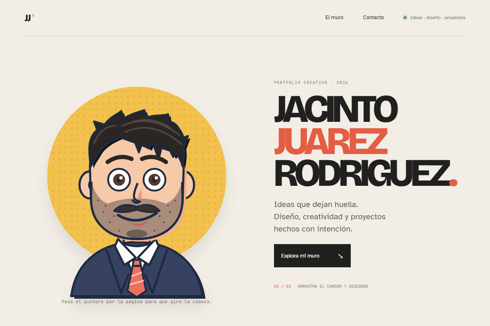

# Portfolio de Jacinto Juárez Rodríguez

Portfolio personal de desarrollador web junior, hecho a mano con **HTML, CSS y JavaScript**, sin frameworks ni proceso de compilación.

**Demo:** <https://jjrodriguez.vercel.app>



## Características

- **Autorretrato SVG por capas** que gira la cabeza siguiendo el puntero (efecto parallax con variables CSS y `requestAnimationFrame`; la animación se detiene cuando el retrato está quieto).
- **Proyectos destacados** en la página principal y **listado completo** sincronizado con la API de GitHub, con caché de una hora para no agotar el límite de peticiones y una lista de respaldo si GitHub no responde.
- **Muro «Sobre mí»** con efecto spray en `canvas`: se descubre pintando, con el botón de cada tarjeta o con «Descubrir todo». Al pintar casi la mitad, la tarjeta se descubre sola.
- **Tema claro/oscuro** compartido por todas las páginas, guardado en `localStorage` y aplicado antes del primer pintado (sin parpadeo).
- **Accesibilidad:** enlace para saltar al contenido, textos alternativos, estados de foco visibles, contraste AA en botones y respeto de `prefers-reduced-motion`.
- **Diseño responsive** probado desde 320 px de ancho; en pantallas táctiles el muro no bloquea el desplazamiento vertical.
- Metadatos SEO y Open Graph para que el enlace se vea bien al compartirlo.

## Estructura

```text
.
├── index.html              # Página principal
├── proyectos.html          # Listado completo de proyectos
├── detalle.html            # Detalle de cada sección del muro (?seccion=...)
├── cv/                     # Currículum en PDF (descarga desde la portada)
├── css/
│   └── portfolio.css       # Estilos compartidos y temas
├── js/
│   ├── theme.js            # Tema claro/oscuro (se carga en <head>)
│   ├── portfolio.js        # Retrato, proyectos destacados, muro y copiar correo
│   ├── card-content.js     # Textos de las secciones del muro
│   ├── card-detail.js      # Renderiza detalle.html
│   ├── projects-data.js    # Datos de los proyectos y creación de tarjetas
│   └── projects.js         # Carga los repositorios desde GitHub
└── images/
```

## Ejecución local

Abre la carpeta con un servidor estático (por ejemplo, la extensión Live Server de VS Code) y visita `index.html`.

## Personalización

- **Proyectos:** en `js/projects-data.js` se elige qué proyectos aparecen en la portada (`featured`), el orden (`order`), los que se ocultan (`hidden`) y el título, la descripción, la imagen, la demo y las tecnologías de cada uno (`details`). Los proyectos con imagen se muestran como tarjeta grande; el resto, como tarjeta compacta.
- **Textos del muro:** en `js/card-content.js`. Las claves deben coincidir con el atributo `data-card-id` de cada tarjeta en `index.html`.
- **CV:** el PDF se genera desde `cv/fuente/cv.html` (edita ahí el texto). Para regenerarlo, ejecuta el comando de Chrome que aparece comentado al principio de ese archivo.
- **LinkedIn:** en la sección `#contacto` de `index.html` hay un bloque comentado listo para añadirlo.
